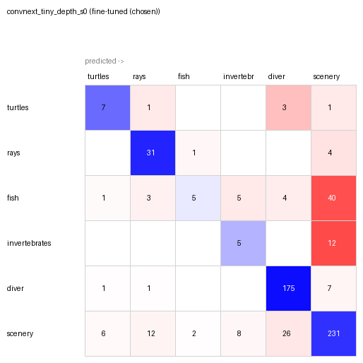

# Underwater Media Tagger

A local app that tags underwater photos and dive videos by subject (turtles, rays, fish,
invertebrates, diver, scenery) and applies color correction tuned to where the subject is.

Work in progress. See `docs/PLAN.md` for the project plan.

## Progress

### Milestone: my whole dive library tagged by an untrained baseline (Nov 3, 2026)

**Frames from my footage.** `tagger/frames.py` sampled 7.2 hours of GoPro video from four dive
trips (plus 94 GoPro photos), one keyframe every 2 seconds. It then dropped clearly ruined frames
(fogged lens, black) and near-duplicates (hovering over the same scene):

| Trip | Sampled | Kept | Dropped as ruined | Dropped as duplicate |
| --- | --- | --- | --- | --- |
| Azores | 4,590 | 4,264 | 20 | 306 |
| Bahamas | 3,303 | 3,249 | 1 | 53 |
| Mexico | 1,556 | 1,345 | 170 | 41 |
| Philippines | 3,896 | 3,624 | 54 | 218 |
| **Total** | **13,345** | **12,482** | **245** | **618** |

Mexico's high drop rate comes from a fogged camera housing on several dives.

**First tagging run: zero-shot CLIP.** Every kept frame was tagged by the baseline: CLIP ViT-B/32
comparing each image to text descriptions of the 7 categories, with no training on this project's
data. This is the "free" score that the fine-tuned model has to beat. All 7 category scores are
stored per frame, not just the top guess.

What CLIP *predicts* is in my footage (unverified guesses, not ground truth):

| Trip | turtles | sharks | rays | fish | invertebrates | diver | scenery |
| --- | --- | --- | --- | --- | --- | --- | --- |
| Azores | 16 | 53 | 319 | 170 | 51 | 1,342 | 2,313 |
| Bahamas | 3 | 9 | 168 | 96 | 15 | 1,278 | 1,680 |
| Mexico | 6 | 0 | 190 | 183 | 23 | 194 | 749 |
| Philippines | 24 | 2 | 282 | 362 | 71 | 919 | 1,964 |
| **Total** | **49** | **64** | **959** | **811** | **160** | **3,733** | **6,706** |

Mean confidence was 0.80, and 990 frames (8%) scored below 0.5.

Early signs of where CLIP struggles, before any hand labels exist:

- **Sharks are over-predicted.** CLIP found 64 "sharks". I have seen exactly one shark in all
  this footage. Most of the 53 Azores "sharks" are likely distant mobula rays.
- **The footage is imbalanced.** About 54% of frames are predicted scenery and 30% diver.
  Turtles, sharks, and invertebrates are rare, which shapes how the test set gets sampled (below).

**Next: an answer key.** Accuracy can't be measured until I hand-label a test sample. Rare
subjects need targeted searching, but sampling only from CLIP's own "turtle" predictions would
leave out every turtle CLIP missed and inflate its score (selection bias). The test set will mix
a random sample, frames I find by browsing clips I remember, and loose CLIP candidates (category
anywhere in its top 3). Each label records how its frame was selected, CLIP's guess stays hidden
while I label, and results will be reported for the random-only subset as well.

### Update: phone photos added, sharks merged into fish (Nov 9, 2026)

**Trip-mates' phone media.** I added 519 frames (446 photos, 73 video frames) from iPhones in
underwater housings, shot on the same Bahamas dives as my GoPro footage. They can appear in the
test set but are never used for training, because they show the same animals on the same dives.
Comparing accuracy on the two cameras will show whether a better GoPro or a phone housing is the
better buy.

**Why sharks are no longer a category.** The labeling page showed me 80 frames with "sharks" in
CLIP's top 3, and none of them were sharks. With no sharks to test on, I couldn't measure that
class on my own footage, and every shark prediction would count as an error, most likely on rays.
Sharks are fish, so they now fall under `fish`, and the project has 6 categories.

What CLIP predicts after the merge (still unverified guesses, not ground truth):

| Trip | turtles | rays | fish | invertebrates | diver | scenery |
| --- | --- | --- | --- | --- | --- | --- |
| Azores | 16 | 347 | 170 | 51 | 1,347 | 2,333 |
| Bahamas | 25 | 196 | 157 | 59 | 1,459 | 1,872 |
| Mexico | 6 | 190 | 183 | 23 | 194 | 749 |
| Philippines | 24 | 283 | 363 | 71 | 919 | 1,964 |
| **Total** | **71** | **1,016** | **873** | **204** | **3,919** | **6,918** |

Mean confidence was 0.80, and 929 frames (7%) scored below 0.5.

**A mistake worth recording.** My first version of the merge moved one shark prompt into the
`fish` prompts. That one sentence cut `fish` predictions from 873 to 483, with 311 frames that had
been `fish` becoming `scenery`, because CLIP averages a category's prompts into a single vector and
the shark wording pulled that vector away from ordinary reef fish. I caught it by comparing
prediction counts before and after, without using any hand labels, and removed the prompt. The
`fish` prompts are unchanged from the 7-category run.

### Milestone: my own classifier, fine-tuned on curated internet photos (Nov 13, 2026)

**Training data: 600 internet photos, 100 per category.** None of it comes from my footage, which
is reserved for testing. Three collectors gathered it for $0.43 in API costs:

- **Animals (turtles, rays, fish, invertebrates): a curation agent.** Claude Sonnet decides which
  iNaturalist species to search next, based on what's being kept and rejected. Claude Haiku checks
  each photo (underwater? animal the main subject? which category?) without seeing iNaturalist's
  label, and a photo is kept only if its answer agrees with the taxonomy. Code enforces variety
  caps per species and per group, so a category can't fill up with nudibranchs.
- **Divers (Wikimedia Commons) and scenery (Commons plus iNaturalist corals and sponges): fixed
  workflows, not agents.** There's no "where to look next" decision for these, so code rotates
  through a fixed list of sources and Haiku does the same check.
- **I hand-checked the filter:** on a random sample of 95 decisions, 98% of kept photos and 93% of
  rejections were correct. One kept photo, a stingray shot from above the water, was removed.

Training and validation are split by photographer (452 / 147 photos), so no one's photos land on
both sides.

**Fine-tuning.** ConvNeXt-Tiny, pretrained on ImageNet-22k, learns the 6 categories in two stages:
first only the new output layer, then the whole network at a low learning rate. Each run takes
about a minute on an RTX 3060. The best epoch is picked on validation only.

**Choosing the color augmentation: where my diving experience came in.** The biggest risk is the
gap between internet photos, which are usually color-corrected, and my GoPro footage, which is
blue-green and murky. So training images get randomly tinted to look like they were taken deeper.
My first version cut red and boosted blue and green. As a diver, I knew that's not what water
does: every color fades with depth, red fastest (it's mostly gone by about 10 m), then green, with
blue lasting longest. Nothing gets brighter; it's the camera's auto-exposure that brightens the
image back up afterwards. I replaced the boost with a physical model: fade each color channel
exponentially with a random depth, at its own rate, then rescale like auto-exposure.

I compared three options over 3 random seeds each, on validation:

| Color augmentation | Balanced accuracy (3 seeds) | Mean |
| --- | --- | --- |
| None | 92.4 / 92.9 / 93.0 | 92.8% |
| Boost (first version) | 90.8 / 92.5 / 92.4 | 91.9% |
| Depth fade (physical) | 91.9 / 90.9 / 91.9 | 91.6% |

No augmentation scored about 1 point higher. That's the expected cost: validation photos are
normally colored internet photos, so training on tinted versions makes the model rely less on exact
colors, which costs a little on normal photos. The benefit can only show up on tinted footage like
mine, which validation doesn't contain. I chose the depth fade anyway, before seeing any test
results, because it matches what my footage actually looks like, and because the app's color
correction will work on exactly these blue-green images. The other two options are scored on the
test set as comparisons, but their results can't change the choice.

### Test results, v1: fine-tuning wins on divers and rays, loses on fish (Nov 13, 2026)

Scored on 592 hand-labeled frames from my own dives (`unusable` excluded), the same frames for
every model. Full tables, confusion matrices, and the frames it got wrong:
[docs/results/v1](docs/results/v1/results.md).

| | CLIP (zero-shot) | Fine-tuned (depth fade) |
| --- | --- | --- |
| **Balanced accuracy** | **62%** | **60%** |
| Accuracy | 72% | 77% |
| Balanced accuracy, randomly picked frames only (237) | 40% | 59% |
| Diver (184 frames) | 76% | 95% |
| Rays (36) | 61% | 86% |
| Scenery (285) | 80% | 81% |
| Turtles (12, from a few encounters) | 58% | 58% |
| Fish (58) | 36% | 9% |
| Invertebrates (17) | 59% | 29% |

**The fine-tuned model ties CLIP overall, for an interesting reason.** It's much better on divers
and rays, and on the unbiased random sample. But it calls most fish (40 of 58) and invertebrates
(12 of 17) `scenery`. In my footage, fish and invertebrates are usually small inside a wide reef
or wreck scene. In the training photos they fill the frame, because iNaturalist is full of
close-up portraits. So the model learned "fish = a big fish in the middle", and a small fish on a
reef looks like a reef. That's a gap in **framing**, not color, so the color augmentation can't
fix it. CLIP, never taught from close-ups, does better on small fish.



Other findings:

- **Color augmentation, on the test set:** depth fade 60%, boost 59%, none 58% (on GoPro frames
  only: 57%, 57%, 54%). The direction matches the reasoning above, but the differences are small
  enough that I treat it as weak evidence, not proof.
- **Scenery gets confused with divers and rays:** a fin at the edge of the frame reads as a diver,
  and dark wreck shapes read as rays.
- **Phone photos (47 frames):** CLIP 73%, fine-tuned 55%. A small sample, but a first clue for the
  GoPro vs. phone question.

**What comes next, without cheating.** The fix is training photos where the animal is small in a
wide scene. But I found the problem by looking at test results, so changing the training and
re-scoring the same frames would turn the test set into a tuning set and make the comparison
with CLIP unfair. Instead, v1's numbers stay as they are here, and for v2 I split my labeled
frames by clip into a dev half, used to study errors and choose fixes, and a holdout half that
stays locked until v2 is final. v2 is reported on the holdout half only.

### v2: closing part of the framing gap (Nov 13, 2026)

**How v2 was developed without spending the test set.** My labeled frames were split by clip
(whole encounters go to one side) into a **dev half** (294 frames) for studying errors and
choosing fixes, and a **holdout half** that stayed locked. I then labeled more frames from
holdout clips only, bringing the holdout to 635 frames. Rare animals were balanced across both
halves, but my footage limits them: the holdout has 11 turtle, 14 invertebrate, and 19 ray frames.

**Two fixes, aimed at the framing gap:**

- **Wide-framing photos (~200):** the curation agent ran again, with Haiku also judging how the
  animal is framed, and kept only medium and wide shots: 50 more training photos per animal
  category. Its instructions also asked for plainer and temperate fish (sea bream, wrasses,
  damselfish), not just colorful reef fish. Most keeps were medium shots; truly wide shots of a
  clear subject are rare online.
- **Zoom-out augmentation:** during training, an animal photo is sometimes shrunk and pasted
  with a soft edge into a random scenery photo, keeping its label. The composites aren't
  realistic (the pasted photo brings its own background), so I only trusted it if the
  measurements agreed.

The same agent run collected a separate **wide-framing validation set** (30 photos per animal
category, from photographers never used for training), so validation could finally see the
problem.

**Choosing v2: 4 variants × 3 seeds, on validation, then the dev half.** "Both fixes" won on wide
validation (99.7% vs. 96.4% for the v1 recipe) and on the dev half (75% vs. 69% balanced
accuracy), and had the best score on randomly picked frames. Zoom-out alone didn't help, but
combined with the real wide photos it gave the best result. One lesson: the wide validation set
turned out too easy (every variant scored 96–100%), because Haiku only kept photos with a clear
subject. It pointed the right way but couldn't separate the variants well; the dev half did that.

**Holdout results: scored once, after v2 was chosen.**

| Holdout half (635 frames) | CLIP (zero-shot) | v1 | **v2** |
| --- | --- | --- | --- |
| **Balanced accuracy** | 56% | 52% | **69%** |
| Accuracy | 73% | 77% | 74% |
| Randomly picked frames only (358) | 41% | 50% | 62% |
| Turtles (11) | 55% | 36% | 64% |
| Rays (19) | 53% | 89% | 84% |
| Fish (56) | 29% | 4% | 27% |
| Invertebrates (14) | 43% | 7% | 79% |
| Diver (229) | 75% | 97% | 95% |
| Scenery (306) | 84% | 80% | 67% |
| Phone photos (57) | 56% | 51% | 76% |

Full tables, confusion matrices, and failures: [docs/results/holdout-v2](docs/results/holdout-v2/results.md).

**What v2 fixed, and what it didn't:**

- **v2 beats CLIP by 13 points** of balanced accuracy on frames that played no part in building
  it, and is strongest on divers, rays, invertebrates, and the trip-mates' phone photos.
- **Invertebrates improved the most** (7% to 79%), and **fish went from 4% to 27%**, roughly level
  with CLIP but still the weakest category. Most missed fish are still called scenery (23 of
  56), and a new confusion appeared: small fish on a reef called invertebrates (11).
- **The price is scenery** (80% to 67%). v2 now sees an animal in some reef shots: of 306 scenery
  frames, 30 were called invertebrates and 20 rays. For a dive tagger, flagging a possible animal
  is a gentle mistake, but it counts as one.
- **A possible contributor to the fish/scenery confusion: my own labels.** Labeling rule 3
  ("background animals don't count") is a judgment call about how prominent a fish has to be,
  and I labeled these frames over several days, so my line between `fish` and `scenery` may not
  be perfectly consistent. I didn't relabel anything after seeing results, since fixing only
  the frames a model disagrees with would bias the answer key toward that model; any labeling
  noise affects CLIP, v1, and v2 equally.

## Findings so far

### Zero-shot CLIP mistakes a camouflaged lizardfish for a ray

The baseline is zero-shot CLIP (ViT-B/32): it scores each image against a few text descriptions
per category, with no training on this project's data. While writing those descriptions, I added
a prompt specifically for camouflaged bottom fish ("a camouflaged flounder, scorpionfish, or
lizardfish lying on the sandy sea floor") and tested it on a lizardfish from my own Azores footage
(`GX050422`, 4:42–4:52). The fish is visible in every frame:


*The 4:50 frame (unedited), the only one CLIP labeled correctly: fish 0.37 vs. scenery 0.33.*

| Time | CLIP's top guess | fish score |
| --- | --- | --- |
| 4:42 | scenery 0.95 | 0.00 |
| 4:44 | rays 0.42 | 0.17 |
| 4:46 | rays 0.45 | 0.09 |
| 4:48 | scenery 0.83 | 0.03 |
| 4:50 | **fish 0.37** | 0.37 |
| 4:52 | rays 0.51 | 0.01 |
| 4:52 (full 4K frame) | rays 0.57 | 0.01 |

CLIP got 1 of 6 frames right, and only narrowly. Three things explain it:

- **"Rays" is the usual wrong answer.** A flat-looking animal on sand, seen from above, matches
  CLIP's idea of a stingray better than its idea of a fish.
- **Averaging dilutes the special-case prompt.** It is 1 of 5 fish prompts. The rest describe
  typical reef fish, so the averaged "fish" vector still means "a fish seen from the side".
- **Low, near-tied scores signal uncertainty.** When the top categories sit within a few points
  of each other, the model is effectively guessing.

I stopped tuning prompts at this point instead of rewording until this example passed. Fitting
the baseline to individual examples, especially ones that may land in the hand-labeled test set,
would inflate the baseline and make the comparison with the fine-tuned model unfair. The prompts
were locked before test labeling began. (The scores above are from the 7-category run, before
sharks were merged into `fish`.)

This is a case where fine-tuning should help: the fine-tuned model trains on real iNaturalist
photos of lizardfish, flounder, and scorpionfish rather than relying on text descriptions.

## Tradeoffs and future work

### Gallery images: full frames now, thumbnails with React

The Streamlit gallery sends full 1920×1080 frames to every grid cell, about 17 MB per
48-image page. I started with 360 px thumbnails, but Streamlit's fullscreen button can only
enlarge the image it was given, so fullscreen showed a blurry, stretched thumbnail and made it
hard to see the subject. Full frames fix that. Over localhost, a page renders in about 1.5 s,
which is fine for a local app.

The React frontend (planned after Nov 23) removes the tradeoff. The grid loads small thumbnails
(about 1.5 MB per page, lazy-loaded as you scroll). A full frame is fetched only when someone
opens it. Thumbnail generation will live in the core `tagger/` package, so the API and any
frontend share it.

### What would change to put this online

The app runs locally by design. Making it public would shift the costs:

- **Images:** with thumbnails, page weight stops being the main cost. Users download full
  frames only for the images they open.
- **Storage:** the frames (5.1 GB for my library alone) and thumbnails would move to object
  storage such as S3, served through a CDN.
- **Compute:** tagging uploads runs CLIP (and later the fine-tuned model). GPU servers are the
  expensive part. CPU inference is cheaper but slower, so tagging would become a background job
  with a queue instead of happening while the user waits.
- **Uploads:** multi-GB dive videos are heavy to upload. Options include extracting frames in the
  browser before upload, or capping file size.
- **Security:** user accounts, per-user upload limits, and abuse protection. Today none are
  needed, because the app only accepts connections from my own machine.

## Setup

Requires Python 3.12 and [uv](https://docs.astral.sh/uv/).

```bash
uv sync            # installs everything, including CUDA PyTorch
uv run pytest      # run tests
uv run ruff check . && uv run ruff format --check .

uv run streamlit run app/streamlit_app.py   # app at http://localhost:8501
```
