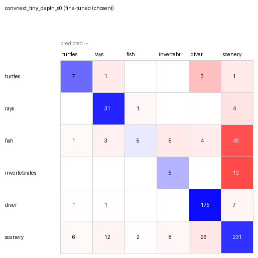
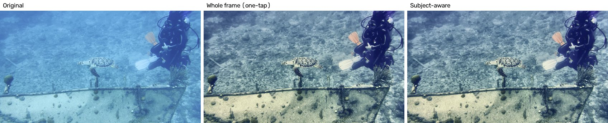
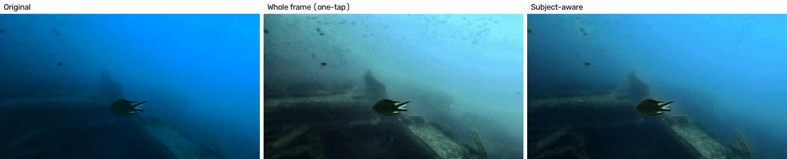
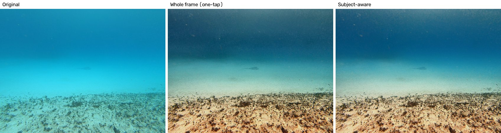
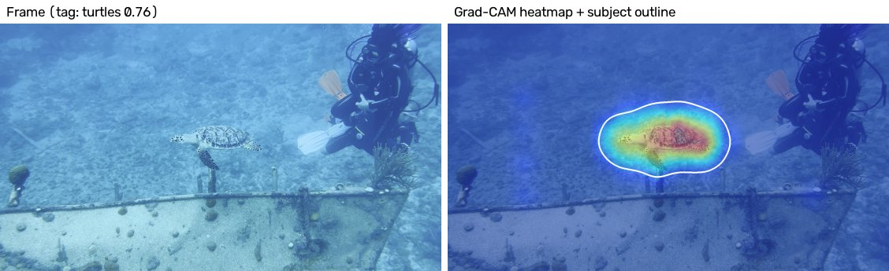
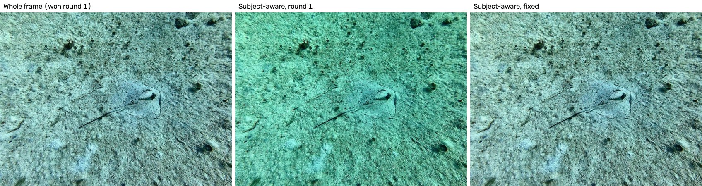
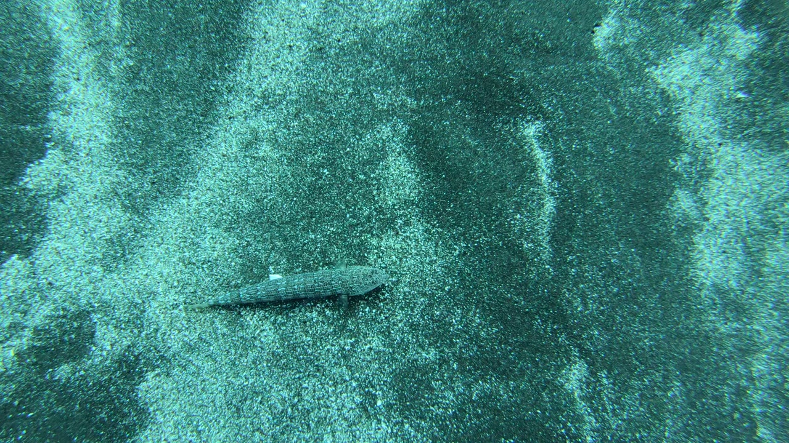

# Underwater Media Tagger

A local app that tags underwater photos and dive videos by subject (turtles, rays, fish,
invertebrates, diver, scenery) and applies color correction tuned to where the subject is.

Work in progress. See `docs/PLAN.md` for the project plan.

## Setup

Requires Python 3.12 and [uv](https://docs.astral.sh/uv/).

```bash
uv sync            # installs everything, including CUDA PyTorch
uv run pytest      # run tests
uv run ruff check . && uv run ruff format --check .

uv run streamlit run app/streamlit_app.py   # app at http://localhost:8501
```

## Progress

### Milestone: my whole dive library tagged by an untrained baseline (Nov 3, 2026)

**Frames from my footage.** `tagger/frames.py` sampled 7.2 hours of GoPro video from four dive
trips (plus 94 GoPro photos), one keyframe every 2 seconds. It then dropped clearly ruined frames
(fogged lens, black) and near-duplicates (hovering over the same scene):

| Trip | Sampled | Kept | Dropped as ruined | Dropped as duplicate |
| --- | --- | --- | --- | --- |
| Azores | 4,590 | 4,264 | 20 | 306 |
| Bahamas | 3,303 | 3,249 | 1 | 53 |
| Mexico | 1,556 | 1,345 | 170 | 41 |
| Philippines | 3,896 | 3,624 | 54 | 218 |
| **Total** | **13,345** | **12,482** | **245** | **618** |

Mexico's high drop rate comes from a fogged camera housing on several dives.

**First tagging run: zero-shot CLIP.** Every kept frame was tagged by the baseline: CLIP ViT-B/32
comparing each image to text descriptions of the 7 categories, with no training on this project's
data. This is the "free" score that the fine-tuned model has to beat. All 7 category scores are
stored per frame, not just the top guess.

What CLIP *predicts* is in my footage (unverified guesses, not ground truth):

| Trip | turtles | sharks | rays | fish | invertebrates | diver | scenery |
| --- | --- | --- | --- | --- | --- | --- | --- |
| Azores | 16 | 53 | 319 | 170 | 51 | 1,342 | 2,313 |
| Bahamas | 3 | 9 | 168 | 96 | 15 | 1,278 | 1,680 |
| Mexico | 6 | 0 | 190 | 183 | 23 | 194 | 749 |
| Philippines | 24 | 2 | 282 | 362 | 71 | 919 | 1,964 |
| **Total** | **49** | **64** | **959** | **811** | **160** | **3,733** | **6,706** |

Mean confidence was 0.80, and 990 frames (8%) scored below 0.5.

Early signs of where CLIP struggles, before any hand labels exist:

- **Sharks are over-predicted.** CLIP found 64 "sharks". I have seen exactly one shark in all
  this footage. Most of the 53 Azores "sharks" are likely distant mobula rays.
- **The footage is imbalanced.** About 54% of frames are predicted scenery and 30% diver.
  Turtles, sharks, and invertebrates are rare, which shapes how the test set gets sampled (below).

**Next: an answer key.** Accuracy can't be measured until I hand-label a test sample. Rare
subjects need targeted searching, but sampling only from CLIP's own "turtle" predictions would
leave out every turtle CLIP missed and inflate its score (selection bias). The test set will mix
a random sample, frames I find by browsing clips I remember, and loose CLIP candidates (category
anywhere in its top 3). Each label records how its frame was selected, CLIP's guess stays hidden
while I label, and results will be reported for the random-only subset as well.

### Update: phone photos added, sharks merged into fish (Nov 9, 2026)

**Trip-mates' phone media.** I added 519 frames (446 photos, 73 video frames) from iPhones in
underwater housings, shot on the same Bahamas dives as my GoPro footage. They can appear in the
test set but are never used for training, because they show the same animals on the same dives.
Comparing accuracy on the two cameras will show whether a better GoPro or a phone housing is the
better buy.

**Why sharks are no longer a category.** The labeling page showed me 80 frames with "sharks" in
CLIP's top 3, and none of them were sharks. With no sharks to test on, I couldn't measure that
class on my own footage, and every shark prediction would count as an error, most likely on rays.
Sharks are fish, so they now fall under `fish`, and the project has 6 categories.

What CLIP predicts after the merge (still unverified guesses, not ground truth):

| Trip | turtles | rays | fish | invertebrates | diver | scenery |
| --- | --- | --- | --- | --- | --- | --- |
| Azores | 16 | 347 | 170 | 51 | 1,347 | 2,333 |
| Bahamas | 25 | 196 | 157 | 59 | 1,459 | 1,872 |
| Mexico | 6 | 190 | 183 | 23 | 194 | 749 |
| Philippines | 24 | 283 | 363 | 71 | 919 | 1,964 |
| **Total** | **71** | **1,016** | **873** | **204** | **3,919** | **6,918** |

Mean confidence was 0.80, and 929 frames (7%) scored below 0.5.

**A mistake worth recording.** My first version of the merge moved one shark prompt into the
`fish` prompts. That one sentence cut `fish` predictions from 873 to 483, with 311 frames that had
been `fish` becoming `scenery`, because CLIP averages a category's prompts into a single vector and
the shark wording pulled that vector away from ordinary reef fish. I caught it by comparing
prediction counts before and after, without using any hand labels, and removed the prompt. The
`fish` prompts are unchanged from the 7-category run.

### Milestone: my own classifier, fine-tuned on curated internet photos (Nov 13, 2026)

**Training data: 600 internet photos, 100 per category.** None of it comes from my footage, which
is reserved for testing. Three collectors gathered it for $0.43 in API costs:

- **Animals (turtles, rays, fish, invertebrates): a curation agent.** Claude Sonnet decides which
  iNaturalist species to search next, based on what's being kept and rejected. Claude Haiku checks
  each photo (underwater? animal the main subject? which category?) without seeing iNaturalist's
  label, and a photo is kept only if its answer agrees with the taxonomy. Code enforces variety
  caps per species and per group, so a category can't fill up with nudibranchs.
- **Divers (Wikimedia Commons) and scenery (Commons plus iNaturalist corals and sponges): fixed
  workflows, not agents.** There's no "where to look next" decision for these, so code rotates
  through a fixed list of sources and Haiku does the same check.
- **I hand-checked the filter:** on a random sample of 95 decisions, 98% of kept photos and 93% of
  rejections were correct. One kept photo, a stingray shot from above the water, was removed.

Training and validation are split by photographer (452 / 147 photos), so no one's photos land on
both sides.

**Fine-tuning.** ConvNeXt-Tiny, pretrained on ImageNet-22k, learns the 6 categories in two stages:
first only the new output layer, then the whole network at a low learning rate. Each run takes
about a minute on an RTX 3060. The best epoch is picked on validation only.

**Choosing the color augmentation: where my diving experience came in.** The biggest risk is the
gap between internet photos, which are usually color-corrected, and my GoPro footage, which is
blue-green and murky. So training images get randomly tinted to look like they were taken deeper.
My first version cut red and boosted blue and green. As a diver, I knew that's not what water
does: every color fades with depth, red fastest (it's mostly gone by about 10 m), then green, with
blue lasting longest. Nothing gets brighter; it's the camera's auto-exposure that brightens the
image back up afterwards. I replaced the boost with a physical model: fade each color channel
exponentially with a random depth, at its own rate, then rescale like auto-exposure.

I compared three options over 3 random seeds each, on validation:

| Color augmentation | Balanced accuracy (3 seeds) | Mean |
| --- | --- | --- |
| None | 92.4 / 92.9 / 93.0 | 92.8% |
| Boost (first version) | 90.8 / 92.5 / 92.4 | 91.9% |
| Depth fade (physical) | 91.9 / 90.9 / 91.9 | 91.6% |

No augmentation scored about 1 point higher. That's the expected cost: validation photos are
normally colored internet photos, so training on tinted versions makes the model rely less on exact
colors, which costs a little on normal photos. The benefit can only show up on tinted footage like
mine, which validation doesn't contain. I chose the depth fade anyway, before seeing any test
results, because it matches what my footage actually looks like, and because the app's color
correction will work on exactly these blue-green images. The other two options are scored on the
test set as comparisons, but their results can't change the choice.

### Test results, v1: fine-tuning wins on divers and rays, loses on fish (Nov 13, 2026)

Scored on 592 hand-labeled frames from my own dives (`unusable` excluded), the same frames for
every model. Full tables, confusion matrices, and the frames it got wrong:
[docs/results/v1](docs/results/v1/results.md).

| | CLIP (zero-shot) | Fine-tuned (depth fade) |
| --- | --- | --- |
| **Balanced accuracy** | **62%** | **60%** |
| Accuracy | 72% | 77% |
| Balanced accuracy, randomly picked frames only (237) | 40% | 59% |
| Diver (184 frames) | 76% | 95% |
| Rays (36) | 61% | 86% |
| Scenery (285) | 80% | 81% |
| Turtles (12, from a few encounters) | 58% | 58% |
| Fish (58) | 36% | 9% |
| Invertebrates (17) | 59% | 29% |

**The fine-tuned model ties CLIP overall, for an interesting reason.** It's much better on divers
and rays, and on the unbiased random sample. But it calls most fish (40 of 58) and invertebrates
(12 of 17) `scenery`. In my footage, fish and invertebrates are usually small inside a wide reef
or wreck scene. In the training photos they fill the frame, because iNaturalist is full of
close-up portraits. So the model learned "fish = a big fish in the middle", and a small fish on a
reef looks like a reef. That's a gap in **framing**, not color, so the color augmentation can't
fix it. CLIP, never taught from close-ups, does better on small fish.



Other findings:

- **Color augmentation, on the test set:** depth fade 60%, boost 59%, none 58% (on GoPro frames
  only: 57%, 57%, 54%). The direction matches the reasoning above, but the differences are small
  enough that I treat it as weak evidence, not proof.
- **Scenery gets confused with divers and rays:** a fin at the edge of the frame reads as a diver,
  and dark wreck shapes read as rays.
- **Phone photos (47 frames):** CLIP 73%, fine-tuned 55%. A small sample, but a first clue for the
  GoPro vs. phone question.

**What comes next, without cheating.** The fix is training photos where the animal is small in a
wide scene. But I found the problem by looking at test results, so changing the training and
re-scoring the same frames would turn the test set into a tuning set and make the comparison
with CLIP unfair. Instead, v1's numbers stay as they are here, and for v2 I split my labeled
frames by clip into a dev half, used to study errors and choose fixes, and a holdout half that
stays locked until v2 is final. v2 is reported on the holdout half only.

### v2: closing part of the framing gap (Nov 13, 2026)

**How v2 was developed without spending the test set.** My labeled frames were split by clip
(whole encounters go to one side) into a **dev half** (294 frames) for studying errors and
choosing fixes, and a **holdout half** that stayed locked. I then labeled more frames from
holdout clips only, bringing the holdout to 635 frames. Rare animals were balanced across both
halves, but my footage limits them: the holdout has 11 turtle, 14 invertebrate, and 19 ray frames.

**Two fixes, aimed at the framing gap:**

- **Wide-framing photos (~200):** the curation agent ran again, with Haiku also judging how the
  animal is framed, and kept only medium and wide shots: 50 more training photos per animal
  category. Its instructions also asked for plainer and temperate fish (sea bream, wrasses,
  damselfish), not just colorful reef fish. Most keeps were medium shots; truly wide shots of a
  clear subject are rare online.
- **Zoom-out augmentation:** during training, an animal photo is sometimes shrunk and pasted
  with a soft edge into a random scenery photo, keeping its label. The composites aren't
  realistic (the pasted photo brings its own background), so I only trusted it if the
  measurements agreed.

The same agent run collected a separate **wide-framing validation set** (30 photos per animal
category, from photographers never used for training), so validation could finally see the
problem.

**Choosing v2: 4 variants × 3 seeds, on validation, then the dev half.** "Both fixes" won on wide
validation (99.7% vs. 96.4% for the v1 recipe) and on the dev half (75% vs. 69% balanced
accuracy), and had the best score on randomly picked frames. Zoom-out alone didn't help, but
combined with the real wide photos it gave the best result. One lesson: the wide validation set
turned out too easy (every variant scored 96–100%), because Haiku only kept photos with a clear
subject. It pointed the right way but couldn't separate the variants well; the dev half did that.

**Holdout results: scored once, after v2 was chosen.**

| Holdout half (635 frames) | CLIP (zero-shot) | v1 | **v2** |
| --- | --- | --- | --- |
| **Balanced accuracy** | 56% | 52% | **69%** |
| Accuracy | 73% | 77% | 74% |
| Randomly picked frames only (358) | 41% | 50% | 62% |
| Turtles (11) | 55% | 36% | 64% |
| Rays (19) | 53% | 89% | 84% |
| Fish (56) | 29% | 4% | 27% |
| Invertebrates (14) | 43% | 7% | 79% |
| Diver (229) | 75% | 97% | 95% |
| Scenery (306) | 84% | 80% | 67% |
| Phone photos (57) | 56% | 51% | 76% |

Full tables, confusion matrices, and failures: [docs/results/holdout-v2](docs/results/holdout-v2/results.md).

**Precision: the number this table was missing** (added Nov 17, same holdout frames). Recall asks
"of the real turtles, how many did it find?" Precision asks "of the frames it *tagged* turtle, how
many were turtles?" For a tagger you browse by tag, precision is what you feel:

| Holdout precision (frames tagged) | CLIP | v1 | v2 |
| --- | --- | --- | --- |
| Turtles | 40% | 44% | 32% (22) |
| Rays | 26% | 55% | 37% (43) |
| Fish | 37% | 29% | 56% (27) |
| Invertebrates | 43% | 8% | 21% (53) |
| Diver | 95% | 82% | 86% |
| Scenery | 74% | 80% | 86% |

Two of every three frames v2 tagged "turtle" weren't turtles. Why that number is so much worse
than recall suggests is the subject of v3.

**What v2 fixed, and what it didn't:**

- **v2 beats CLIP by 13 points** of balanced accuracy on frames that played no part in building
  it, and is strongest on divers, rays, invertebrates, and the trip-mates' phone photos.
- **Invertebrates improved the most** (7% to 79%), and **fish went from 4% to 27%**, roughly level
  with CLIP but still the weakest category. Most missed fish are still called scenery (23 of
  56), and a new confusion appeared: small fish on a reef called invertebrates (11).
- **The price is scenery** (80% to 67%). v2 now sees an animal in some reef shots: of 306 scenery
  frames, 30 were called invertebrates and 20 rays. For a dive tagger, flagging a possible animal
  is a gentle mistake, but it counts as one.
- **A possible contributor to the fish/scenery confusion: my own labels.** Labeling rule 3
  ("background animals don't count") is a judgment call about how prominent a fish has to be,
  and I labeled these frames over several days, so my line between `fish` and `scenery` may not
  be perfectly consistent. I didn't relabel anything after seeing results, since fixing only
  the frames a model disagrees with would bias the answer key toward that model; any labeling
  noise affects CLIP, v1, and v2 equally.

**Known failure modes, seen while using the app.** Browsing the library with v2's tags, two
kinds of mistakes stand out. These are observations, not measurements:

- **Close-up divers.** GoPro footage is full of masks and faces right at the lens, but the
  Wikimedia Commons diver photos v2 trained on mostly show whole divers from a distance.
- **Low light.** Dark, murky moments (deeper water, overhangs, dusk) are common in my footage,
  while the training photos are mostly well-lit internet shots. The depth-fade augmentation
  changes color, not brightness or noise.

Both have plausible fixes (close-up diver photos in training, a low-light augmentation), but the
holdout has already been used to score v2, so a v3 would need a fresh, untouched test set to be
measured honestly. Mistakes can be fixed by hand in the app instead: a manual correction
replaces the shown tag (and what search finds) without touching the model or my test labels.

### v3: v2 saw turtles in the Azores, where there are none (Nov 17, 2026)

**How it was found: by using the app, not by the metrics.** Browsing the Azores trip, v2 had
tagged about 115 frames as turtles. I saw no turtles on that trip. A random sample of the tags
showed mossy rounded boulders, overhangs, and wreck hulls. Its holdout balanced accuracy (69%)
hadn't hinted at this.

**Why a 69% model can still bury you in false turtles: base rates.** Turtles are a few dozen of
my 12,000 frames; scenery is thousands. If the model mistakes even 1% of scenery frames for
turtles, that's more false turtles than real ones. Balanced accuracy averages *recall* per
category, so it never sees this. Precision does. Two things made it worse:

- **The training mix taught the wrong odds.** v2 trained on 127 turtle photos and only 68
  scenery photos. A classifier's probabilities absorb its training mix, so it treated "turtle"
  as a common answer.
- **v2 had never seen temperate scenery.** Its scenery photos were mostly tropical coral. The
  Azores are volcanic rock, boulders, and algae, which v2 had only ever seen behind animals.

**What I changed:**

1. **165 temperate scenery photos** (Portugal, Spain, the Mediterranean, the UK, Cape Verde,
   kelp forests, rocky reefs, wrecks), through the same Haiku-checked scenery workflow, for
   $0.08. I reviewed a contact sheet and removed 6: half-above-water shots, a lab specimen, and a
   duplicate. Two shots of divers in front of a wreck moved to `diver`, matching how I had
   labeled the same kind of scene in my own footage.
2. **Balanced sampling:** every training batch draws each category equally often, whatever its
   photo count.
3. **Selection by macro-F1** (the per-category balance of precision and recall), not balanced
   accuracy, so over-tagging one category costs a model. The evaluation report now shows
   precision and macro-F1 for every model.
4. **Two checks from what I know about my footage**, with no labels involved: turtle tags in the
   Azores and ray tags in Mexico. Neither trip had any, so both counts should be near zero.

**What didn't work: correcting for base rates after training.** The textbook fix for "the
training mix differs from the real one" is to re-weight the model's probabilities by Bayes'
rule toward the real mix, which you can estimate from the model's own predictions on unlabeled
data with an EM algorithm (Saerens et al., 2002). It needs no labels and no retraining
([tagger/prior.py](tagger/prior.py)), and it passed its unit tests on synthetic data. On my
library it collapsed:

| Dev half (294 frames) | Balanced accuracy | Macro-F1 | Azores turtle tags |
| --- | --- | --- | --- |
| v2 | 75% | 64% | 115 |
| v2 + EM correction, per trip | 30% | 26% | 0 |
| v2 + EM correction, whole library | 30% | 26% | 0 |

It removed the false turtles by removing *every* animal: the estimated mix for each trip came
out about 60% diver and 40% scenery, and animal recall fell to 0%. The method assumes the only
difference between training and real data is how common each category is ("label shift"). Here
the images themselves differ too: sharp internet close-ups vs. murky GoPro frames. On frames
it doesn't recognize, v2 leans toward diver and scenery; EM reads that as "this library is all
divers and scenery" and amplifies it with each round. I kept the module and its tests as a
record of the attempt, and fixed the problem in the training data instead.

**First v3 results (dev half, 3 seeds per recipe, each recipe also averaged over its seeds):**

| Dev half (294 frames) | Balanced accuracy | Macro-F1 | Azores turtles | Mexico rays |
| --- | --- | --- | --- | --- |
| CLIP | 65% | 63% | 16 | 190 |
| v2 | **75%** | 64% | 115 | 168 |
| v3 balanced, 3-seed average | 69% | **66%** | 31 | 80 |

False animals fell by half to three quarters, and precision rose where dev has enough frames to
judge (scenery recall 72% → 90%, ray precision 68% → 88%, diver precision 85% → 94%). Balanced
accuracy fell, but that drop is one turtle frame (of 3 in dev) and two invertebrate frames (of
9): rare categories make dev noisy.

**Cleaning up the library on the way.** Checking per-trip counts turned up three Bahamas files
recorded as Philippines (one clip had been misfiled on the drive when frames were extracted; GoPro
file numbering gave it away), a snorkeling clip still in the library, and duplicate test
uploads. Fixed and removed, so dev now scores 277 frames.

**Tuning v3 further: a factorial sweep.** Three more training tweaks were candidates: a larger
input size (320 px instead of 224, so small fish keep more pixels), more zoom-out (50% instead
of 30%), and Mixup/CutMix (training on blends of two photos, which discourages overconfident
answers). Two after-the-fact tweaks were also candidates: averaging with the mirror image, and
smoothing each video frame with its neighbors. The smoothing idea is that a real turtle stays in
view for several 2-second frames, while a shell-shaped boulder is often a one-frame blip
([tagger/smooth.py](tagger/smooth.py)).

Stacking tweaks one after another can't tell whether a tweak helps on its own or only alongside
another. So [training/sweep.py](training/sweep.py) trains every combination (2 × 2 × 2 × 3 seeds
= 24 runs). It estimates each tweak's effect as the average of 12 runs with it minus 12 without,
plus how much each pair interacts. Everything is scored on validation, the dev half, and the two
known-absent counts; the holdout isn't touched.

| Tweak (with minus without) | Dev macro-F1 | Dev balanced acc. | Azores turtles | Mexico rays |
| --- | --- | --- | --- | --- |
| 320 px input | **+5.5** | +0.4 | **−30** | −10 |
| 50% zoom-out | 0.0 | +0.4 | −5 | +12 |
| Mixup | −0.2 | −0.4 | +11 | −8 |
| Mirror-image averaging | +1.5 | +0.4 | −4 | −1 |
| Smoothing ±2.5 s (1 neighbor each side) | **+4.1** | +0.2 | **−27** | **−24** |
| Smoothing ±4.5 s (2 neighbors each side) | +3.6 | −1.5 | −36 | −30 |
| *Seed-to-seed spread* | *±1.7* | *±2.8* | *±23* | *±19* |

Testing the tweaks separately mattered twice, because of interactions:

- **50% zoom-out looks harmless on average but costs 6.6 points of macro-F1 combined with
  320 px.** Added after 320 px, it would have looked neutral and quietly cost those points.
- **Mixup looks useless on average, but helps at 320 px.** At 224 px it adds false turtles; at
  320 px it cuts false Mexico rays from 82 to 53 per model, consistently across seeds.

The wider smoothing window removed more false animals but started erasing short real
sightings (balanced accuracy −1.5), so v3 uses ±2.5 s.

**v3 as chosen:** 320 px input, 30% zoom-out, Mixup, three seeds averaged, mirror-image
averaging, and ±2.5 s smoothing on video frames ([tagger/classify.py](tagger/classify.py)). It
now tags the whole library and uploads in the app. The sweep scored on 366 px pre-shrunk frames
to save time; tagging full frames moved the numbers slightly (dev macro-F1 80.1% → 80.0%,
Mexico rays 30 → 50, within seed noise). The full-frame numbers are the ones below.

| Whole library (no labels needed) | v2 | v3 |
| --- | --- | --- |
| Turtle tags in the Azores (none there) | 115 | **13** |
| Ray tags in Mexico (none there) | 168 | **50** |

**Holdout, second look** ([docs/results/holdout-v3](docs/results/holdout-v3/results.md), 640
frames):

| Holdout | Balanced accuracy | Macro-F1 | Accuracy |
| --- | --- | --- | --- |
| CLIP | 56% | 53% | 74% |
| v2 | **69%** | 55% | 74% |
| v3 | 67% | **68%** | **81%** |

| Precision (holdout) | CLIP | v2 | v3 |
| --- | --- | --- | --- |
| turtles | 40% | 32% | **67%** |
| rays | 26% | 37% | **87%** |
| fish | 37% | 56% | **77%** |
| invertebrates | 43% | 21% | **60%** |

v3 did what it was built for: when it names an animal, it's now right most of the time, and
the false animals in the library fell by 70–90%. But **its balanced accuracy did not beat v2's
on the holdout** (67% vs. 69%), even though it did on dev (77% vs. 75%). v3 is more cautious:
ray recall fell from 84% to 68%, invertebrates from 79% to 64%, and fish from 27% to 18%. On
dev, where every v3 choice was made, the trade looked free. On frames it wasn't tuned on, part
of it came back. That gap is the cost of choosing among many candidates on 277 dev frames, and
it's why the holdout exists.

Which model is "better" depends on use. For browsing a library ("show me my rays"), precision
matters more: a page of rays that are 87% rays beats one that is 37% rays. That's why the app
runs v3.

**v3's known weaknesses**

- **Fish are mostly missed.** Fish recall is 18% on the holdout (36% on dev): small fish in
  wide shots are still called scenery, as for every model including CLIP. When v3 does say fish,
  it's right 77% of the time.
- **Cautious on rare animals.** Recall for rays and invertebrates fell compared with v2 (see
  above): the price of fewer false tags.
- **Weakest on my GoPro footage and in the Azores.** GoPro-frame balanced accuracy is 55% (v2:
  63%), against 82% on trip-mates' phone photos. The Azores slice is 51%. Murky temperate
  water is the furthest from the internet training photos.
- **Rounded rock still reads as turtle sometimes.** 13 false Azores turtles remain: mossy
  boulders, overhangs, and wreck parts. Fixing this needs more temperate training photos;
  Wikimedia Commons ran out under the per-photographer cap, and my own Azores footage can't be
  used because it's test data.
- **There's no `unusable` class.** Surface, boat, and fogged frames are excluded from scoring,
  but in the gallery they're forced into one of the six categories. A seventh class is the real
  fix, but it changes the evaluation design.
- **Rare categories are measured on very few frames:** 3 turtles and 9 invertebrates in dev, 11
  and 14 in the holdout. A single frame moves turtle recall by 9–33 points.
- **The holdout is now spent twice.** It scored v2 once, and v3 as a labeled second look. v3's
  fixes came partly from patterns I saw in the library, which includes holdout clips, so these
  numbers are weaker evidence than v2's were. A next model needs newly labeled footage from a
  new trip.

### Subject-aware color correction: the classifier shows where to correct (Nov 18–20, 2026)

Water absorbs red light first, so dive photos come out blue-green and flat. One-tap tools
(phone apps, auto white balance) measure the color cast on the whole frame. In a dive photo
most of the frame is water, so the water decides the correction. Underwater photographers do it
differently in Lightroom: they white-balance on something that should be neutral, mask the
subject and correct it fully, and mask the water separately to keep it blue. This feature
automates that workflow. The classifier already knows where the animal is, so no one draws a
mask by hand.







*Whole frame neutralizes the water to gray-teal. Subject-aware measures the color on the
subject and keeps the water blue. Strength 0.8, the app's default.*

**1. Find the subject with Grad-CAM (`tagger/locate.py`).** Grad-CAM asks the CNN where its
evidence for a tag was: it weights the last feature map's channels by how much each pushed the
score toward, say, "turtle". This is one reason v3 is a CNN (ConvNeXt), not a vision
transformer. The heatmap is averaged over v3's three seeds, and the hot region becomes a soft
mask, grown and feathered. Scenery, unusable frames, and tags under 0.5 confidence fall back
to whole-frame correction: low-confidence tags are mostly the wrong ones (false Azores turtles
have a median confidence of 0.37).



**2. Correct like a photographer (`tagger/color.py`).** No learned model here, just classic image
processing modeled on Lightroom and DaVinci Resolve workflows:

- Rebuild the red channel from green (Ancuti et al., 2018), as video editors do for footage
  shot without a red filter. White balance alone can't fix a nearly empty channel.
- White-balance on the least colorful pixels: an automated eyedropper. The red gain is never
  below 1, because water removes red and never adds it. This keeps an orange nudibranch orange.
- Keep open water blue: it gets half the correction and is darkened 5%, which also hides
  floating particles. Water is found by color and smoothness, not by the Grad-CAM mask, whose
  soft blob would show as a halo.
- Levels, light local contrast, a gentle contrast curve and edge-only sharpening. Shallow
  frames, where red still survives, get less of everything.

Settings were chosen by eye on one frame set (A) and judged on others. Red was dialed back to
80%, because full correction looked too warm.

**Does the outline land on the subject?** I marked frames strictly: a hit means the outline
covers the whole subject, because a color correction needs all of it.

| Masks | Frames | Covers the whole subject | On the subject at all |
| --- | --- | --- | --- |
| As first built (set B) | 19 | 7 (37%) | 18 (95%) |
| Grown 12%, nearby hot spots joined (fresh pool frames) | 22 | 13 (59%) | 22 (100%) |

Grad-CAM finds the right place but stops short of the edges: it marks the most telling parts,
such as a diver's fins rather than the torso. In set B, 8 of the 27 frames that passed the
0.5 confidence gate had no subject a stranger could see, so they weren't counted.

**Agent A, Haiku as a second marker: didn't pass.** Haiku 5.5 marked the same frames with the
same definitions. Its larger count would only be used if it agreed with me on at least 80% of
set B, a bar set before its first run. It reached 59%, then 74% after we both switched to the
strict definition (its reasons showed I'd been lenient). So its count isn't used.

**The blind test.** There's no ground truth for "correct" underwater color, so I judged. Each
frame was corrected both ways and shown side by side, in a random order with the methods
unnamed. I picked left, right, or no difference. I could flip between them with the arrow keys,
and flag frames whose tag was wrong. The rule was set before testing: subject-aware must win at
least 60% of the votes that aren't ties.

| | Round 1 (24 pairs, set C) | Round 2 (30 fresh pairs) |
| --- | --- | --- |
| Subject-aware / whole frame / no difference | 8 / 8 / 4 | 16 / 2 / 7 |
| Win rate (95% range) | 50% (28–72%): **fails** | 89% (67–97%), p = 0.0007: **passes** |
| Rays | 0–5 | 6–0 |
| Turtles / divers / fish | 1–0 / 6–0 / 1–2 | 4–0 / 4–1 / 2–1 |
| Flagged as wrong tags (not counted) | 4 | 5 |
| Sonnet agrees with my pick (agent B) | 54% | 60% |

**Round 1 failed, and the ray frames show why.** Four of the five rays were shot looking down
at sand, with no open water in view. The water detection assumed the least red pixels were
water, but here they were sand, so the whole sea floor kept the water's half-strength
correction and stayed cyan:



*Left and middle: the round 1 pair as I voted on it. Right: after the fix. With no open water,
the subject's correction now applies everywhere.*

**The fix:** open water is smooth and sand is textured. On set A, open water's local brightness
variation is under 0.01 (on a 0–1 scale), while sand and reef sit at 0.02–0.08. A pixel now
counts as water only inside a sizeable smooth area. A frame with less than 5% of it has no
water at all. Round 2 tested the fixed version on 30 fresh frames, and rays went from 0–5 to
6–0.

**Read round 2 with its caveats.** It used different frames from round 1. The fix was designed
after seeing round 1 fail, and I knew a fix was being tested (though each pair was still
blind). Round 1 remains the pre-registered result. After round 2, others who looked at the
results said wide shots had too much gradient. Clarity and contrast were stretching the
water's natural falloff into blotches, so open water now gets neither, as in Adobe's own
example. No blind round covers that last change.

**Agent B, Sonnet as a second judge.** Sonnet 5.5 judged the same pairs, in its own random
order, only after all my votes were in ($0.18 and $0.21). It agreed with my pick on 54% and
60% of pairs, mostly because it called far more pairs "no difference" (19 of 25 in round 2).
Where it did pick, it leaned the same way as me in round 2 (5 to 1).

**In the app:** open an image's details and switch on Color correction. It shows the corrected
image, the heatmap, and the original. Controls cover the mode (subject or whole frame),
strength, contrast and sharpness presets, and the two water switches. There's also a reset
button and a full-resolution download. Uploads get the same view.

**Known weaknesses**

- **Grad-CAM misses some subjects entirely.** #5705: evidence on a hand and a regulator, not the
  diver. #3990: a camouflaged fish, with evidence on the sand texture. #8667: a second hot spot
  on a finger.
- **Wrong tags pass the 0.5 gate.** I flagged 9 blind-test frames whose tagged subject wasn't
  there, including a lionfish tagged invertebrates (its feathery fins look like a crinoid). In
  the Grad-CAM checks, an eel was also tagged invertebrates, and two Azores frames tagged
  turtles had no turtle.
- **Small samples.** 24 and 30 votes from one judge. Per-category results rest on 1–6 frames
  each, and invertebrates got almost no real votes in round 2.
- **Stills only.** In video, subject mode would flicker more than whole frame, because the mask
  moves and frames near 0.5 confidence switch modes. The code separates measuring from
  applying, so settings could be smoothed over a clip later.
- **Some frames still look off to me.** These are hand-built steps, not a learned correction.
  A learned model would need reference photos, which I don't have.

## Findings so far

### Zero-shot CLIP mistakes a camouflaged lizardfish for a ray

The baseline is zero-shot CLIP (ViT-B/32): it scores each image against a few text descriptions
per category, with no training on this project's data. While writing those descriptions, I added
a prompt specifically for camouflaged bottom fish ("a camouflaged flounder, scorpionfish, or
lizardfish lying on the sandy sea floor") and tested it on a lizardfish from my own Azores footage
(`GX050422`, 4:42–4:52). The fish is visible in every frame:



*The 4:50 frame (unedited), the only one CLIP labeled correctly: fish 0.37 vs. scenery 0.33.*

| Time | CLIP's top guess | fish score |
| --- | --- | --- |
| 4:42 | scenery 0.95 | 0.00 |
| 4:44 | rays 0.42 | 0.17 |
| 4:46 | rays 0.45 | 0.09 |
| 4:48 | scenery 0.83 | 0.03 |
| 4:50 | **fish 0.37** | 0.37 |
| 4:52 | rays 0.51 | 0.01 |
| 4:52 (full 4K frame) | rays 0.57 | 0.01 |

CLIP got 1 of 6 frames right, and only narrowly. Three things explain it:

- **"Rays" is the usual wrong answer.** A flat-looking animal on sand, seen from above, matches
  CLIP's idea of a stingray better than its idea of a fish.
- **Averaging dilutes the special-case prompt.** It is 1 of 5 fish prompts. The rest describe
  typical reef fish, so the averaged "fish" vector still means "a fish seen from the side".
- **Low, near-tied scores signal uncertainty.** When the top categories sit within a few points
  of each other, the model is effectively guessing.

I stopped tuning prompts at this point instead of rewording until this example passed. Fitting
the baseline to individual examples, especially ones that may land in the hand-labeled test set,
would inflate the baseline and make the comparison with the fine-tuned model unfair. The prompts
were locked before test labeling began. (The scores above are from the 7-category run, before
sharks were merged into `fish`.)

This is a case where fine-tuning should help: the fine-tuned model trains on real iNaturalist
photos of lizardfish, flounder, and scorpionfish rather than relying on text descriptions.

## Tradeoffs and future work

### Gallery images: full frames now, thumbnails with React

The Streamlit gallery sends full 1920×1080 frames to every grid cell, about 17 MB per
48-image page. I started with 360 px thumbnails, but Streamlit's fullscreen button can only
enlarge the image it was given, so fullscreen showed a blurry, stretched thumbnail and made it
hard to see the subject. Full frames fix that. Over localhost, a page renders in about 1.5 s,
which is fine for a local app.

The React frontend (planned after Nov 23) removes the tradeoff. The grid loads small thumbnails
(about 1.5 MB per page, lazy-loaded as you scroll). A full frame is fetched only when someone
opens it. Thumbnail generation will live in the core `tagger/` package, so the API and any
frontend share it.

### What would change to put this online

The app runs locally by design. Making it public would shift the costs:

- **Images:** with thumbnails, page weight stops being the main cost. Users download full
  frames only for the images they open.
- **Storage:** the frames (5.1 GB for my library alone) and thumbnails would move to object
  storage such as S3, served through a CDN.
- **Compute:** tagging uploads runs CLIP (and later the fine-tuned model). GPU servers are the
  expensive part. CPU inference is cheaper but slower, so tagging would become a background job
  with a queue instead of happening while the user waits.
- **Uploads:** multi-GB dive videos are heavy to upload. Options include extracting frames in the
  browser before upload, or capping file size.
- **Security:** user accounts, per-user upload limits, and abuse protection. Today none are
  needed, because the app only accepts connections from my own machine.

### Color correction next steps

- **Video:** correct whole clips by smoothing the measured settings over time, and blend between
  subject and whole-frame modes instead of switching, so the color doesn't flicker.
- **A learned correction:** train on pairs of raw and hand-edited photos. Hand-built steps
  plateau, and some frames still look off.
- **Tighter masks:** a segmentation model (or Grad-CAM refined along image edges) would cover
  whole subjects, not just their most telling parts.
