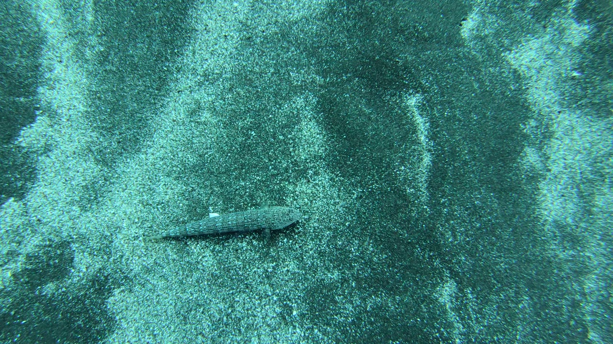

# Underwater Media Tagger

A local app that tags underwater photos and dive videos by subject (turtles, sharks, rays, fish,
invertebrates, diver, scenery) and applies color correction tuned to where the subject is.

Work in progress. See `CLAUDE.md` for the project plan.

## Progress

### Milestone: my whole dive library tagged by an untrained baseline (Nov 3, 2026)

**Frames from my footage.** `tagger/frames.py` sampled 7.2 hours of GoPro video from four dive
trips (plus 94 GoPro photos), one keyframe every 2 seconds. It then dropped clearly ruined frames
(fogged lens, black) and near-duplicates (hovering over the same scene):

| Trip | Sampled | Kept | Dropped as ruined | Dropped as duplicate |
| --- | --- | --- | --- | --- |
| Azores | 4,590 | 4,264 | 20 | 306 |
| Bahamas | 3,303 | 3,249 | 1 | 53 |
| Mexico | 1,556 | 1,345 | 170 | 41 |
| Philippines | 3,896 | 3,624 | 54 | 218 |
| **Total** | **13,345** | **12,482** | **245** | **618** |

Mexico's high drop rate comes from a fogged camera housing on several dives.

**First tagging run: zero-shot CLIP.** Every kept frame was tagged by the baseline: CLIP ViT-B/32
comparing each image to text descriptions of the 7 categories, with no training on this project's
data. This is the "free" score that the fine-tuned model has to beat. All 7 category scores are
stored per frame, not just the top guess.

What CLIP *predicts* is in my footage (unverified guesses, not ground truth):

| Trip | turtles | sharks | rays | fish | invertebrates | diver | scenery |
| --- | --- | --- | --- | --- | --- | --- | --- |
| Azores | 16 | 53 | 319 | 170 | 51 | 1,342 | 2,313 |
| Bahamas | 3 | 9 | 168 | 96 | 15 | 1,278 | 1,680 |
| Mexico | 6 | 0 | 190 | 183 | 23 | 194 | 749 |
| Philippines | 24 | 2 | 282 | 362 | 71 | 919 | 1,964 |
| **Total** | **49** | **64** | **959** | **811** | **160** | **3,733** | **6,706** |

Mean confidence was 0.80, and 990 frames (8%) scored below 0.5.

Early signs of where CLIP struggles, before any hand labels exist:

- **Sharks are over-predicted.** CLIP found 64 "sharks". I have seen exactly one shark in all
  this footage. Most of the 53 Azores "sharks" are likely distant mobula rays.
- **The footage is imbalanced.** About 54% of frames are predicted scenery and 30% diver.
  Turtles, sharks, and invertebrates are rare, which shapes how the test set gets sampled (below).

**Next: an answer key.** Accuracy can't be measured until I hand-label a test sample. Rare
subjects need targeted searching, but sampling only from CLIP's own "turtle" predictions would
leave out every turtle CLIP missed and inflate its score (selection bias). The test set will mix
a random sample, frames I find by browsing clips I remember, and loose CLIP candidates (category
anywhere in its top 3). Each label records how its frame was selected, CLIP's guess stays hidden
while I label, and results will be reported for the random-only subset as well.

## Findings so far

### Zero-shot CLIP mistakes a camouflaged lizardfish for a ray

The baseline is zero-shot CLIP (ViT-B/32): it scores each image against a few text descriptions
per category, with no training on this project's data. While writing those descriptions, I added
a prompt specifically for camouflaged bottom fish ("a camouflaged flounder, scorpionfish, or
lizardfish lying on the sandy sea floor") and tested it on a lizardfish from my own Azores footage
(`GX050422`, 4:42–4:52). The fish is visible in every frame:



*The 4:50 frame (unedited), the only one CLIP labeled correctly: fish 0.37 vs. scenery 0.33.*

| Time | CLIP's top guess | fish score |
| --- | --- | --- |
| 4:42 | scenery 0.95 | 0.00 |
| 4:44 | rays 0.42 | 0.17 |
| 4:46 | rays 0.45 | 0.09 |
| 4:48 | scenery 0.83 | 0.03 |
| 4:50 | **fish 0.37** | 0.37 |
| 4:52 | rays 0.51 | 0.01 |
| 4:52 (full 4K frame) | rays 0.57 | 0.01 |

CLIP got 1 of 6 frames right, and only narrowly. Three things explain it:

- **"Rays" is the usual wrong answer.** A flat-looking animal on sand, seen from above, matches
  CLIP's idea of a stingray better than its idea of a fish.
- **Averaging dilutes the special-case prompt.** It is 1 of 5 fish prompts. The rest describe
  typical reef fish, so the averaged "fish" vector still means "a fish seen from the side".
- **Low, near-tied scores signal uncertainty.** When the top categories sit within a few points
  of each other, the model is effectively guessing.

I stopped tuning prompts at this point instead of rewording until this example passed. Fitting
the baseline to individual examples, especially ones that may land in the hand-labeled test set,
would inflate the baseline and make the comparison with the fine-tuned model unfair. The prompts
were locked before test labeling began.

This is a case where fine-tuning should help: the fine-tuned model trains on real iNaturalist
photos of lizardfish, flounder, and scorpionfish rather than relying on text descriptions.

## Tradeoffs and future work

### Gallery images: full frames now, thumbnails with React

The Streamlit gallery sends full 1920×1080 frames to every grid cell, about 17 MB per
48-image page. I started with 360 px thumbnails, but Streamlit's fullscreen button can only
enlarge the image it was given, so fullscreen showed a blurry, stretched thumbnail and made it
hard to see the subject. Full frames fix that. Over localhost, a page renders in about 1.5 s,
which is fine for a local app.

The React frontend (planned after Nov 23) removes the tradeoff. The grid loads small thumbnails
(about 1.5 MB per page, lazy-loaded as you scroll). A full frame is fetched only when someone
opens it. Thumbnail generation will live in the core `tagger/` package, so the API and any
frontend share it.

### What would change to put this online

The app runs locally by design. Making it public would shift the costs:

- **Images:** with thumbnails, page weight stops being the main cost. Users download full
  frames only for the images they open.
- **Storage:** the frames (5.1 GB for my library alone) and thumbnails would move to object
  storage such as S3, served through a CDN.
- **Compute:** tagging uploads runs CLIP (and later the fine-tuned model). GPU servers are the
  expensive part. CPU inference is cheaper but slower, so tagging would become a background job
  with a queue instead of happening while the user waits.
- **Uploads:** multi-GB dive videos are heavy to upload. Options include extracting frames in the
  browser before upload, or capping file size.
- **Security:** user accounts, per-user upload limits, and abuse protection. Today none are
  needed, because the app only accepts connections from my own machine.

## Setup

Requires Python 3.12 and [uv](https://docs.astral.sh/uv/).

```bash
uv sync            # installs everything, including CUDA PyTorch
uv run pytest      # run tests
uv run ruff check . && uv run ruff format --check .

uv run streamlit run app/streamlit_app.py   # app at http://localhost:8501
```
